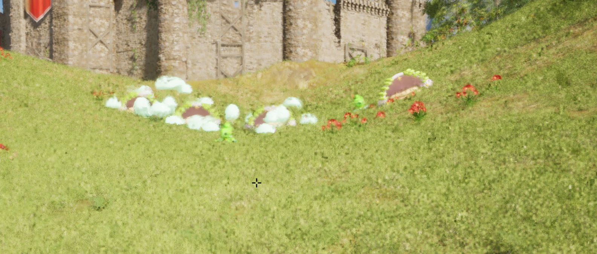
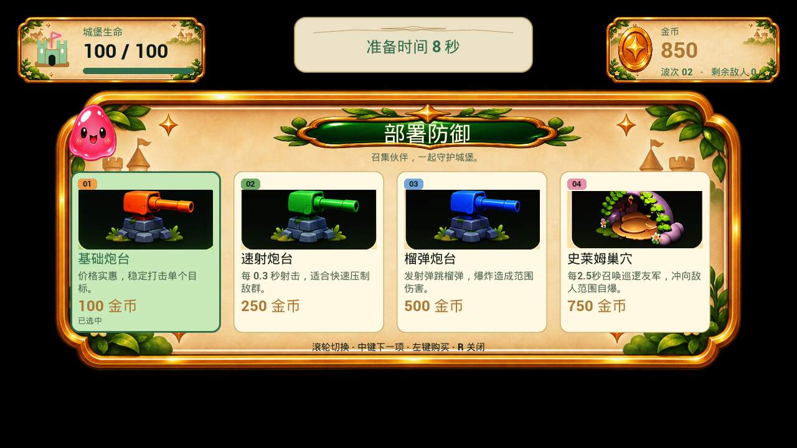

# BLOB DEFENSE

**部署防线，守护城堡。** 一款正在开发中的第一人称单人波次塔防游戏，使用 Unreal Engine 制作。

你可以亲自拿起武器阻挡 Blob，也可以花费击杀所得的金币部署炮台与友方巢穴，在越来越有挑战的波次中守护城堡。

## 游戏特色

- **第一人称战斗与塔防结合**：移动、冲刺、射击，也能部署防御设施。
- **三类炮台**：基础炮台、绿色速射炮台、蓝色榴弹炮台。
- **友方巢穴**：召唤随机配色、不同体型的友方 Blob，巡逻并冲向敌人自爆。
- **波次敌人**：普通 Blob、会追逐玩家的阿尔法 Blob，以及戴王冠的波尾大 Blob。
- **可调整的声音与画面**：中文默认界面，音乐和枪械/炮台声音可调，可切换原版与可爱音效。
- **失败后自由观察**：城堡或玩家倒下后，可以重来、返回主菜单，或隐藏菜单观察时停场景。

## 截图

### 城堡关卡实机画面

### 防御部署界面

截图来自开发过程；商店截图为界面预览，图中的资源外观、数值和界面可能与最新试玩版有所差异。

## 如何试玩

目标平台：**Windows 64 位**。游戏独立运行，不需要安装 Unreal Engine 或 Visual Studio。

**当前仓库先提供介绍、截图和说明，试玩包尚未发布到 Releases。** 后续下载附件应从本仓库的 [Releases 页面](../../releases) 获取，GitHub 的 “Code → Download ZIP” 只会下载这些展示资料。

拿到试玩包后，请完整解压并运行最外层的 `FirstProject.exe`。不要单独移动 exe 或删除旁边的 `Engine`、`FirstProject` 文件夹。若提示缺少 VC++ 运行库，请安装包内 `Prerequisites/VC_redist.x64.exe`。

详见 [操作与玩法说明](docs/HOW_TO_PLAY.md) 和 [运行常见问题](docs/TROUBLESHOOTING.md)。目前尚未完成多机硬件兼容性测试。

## 快速操作

| 操作 | 按键 |
| --- | --- |
| 移动 / 观察 | W、A、S、D / 鼠标 |
| 跳跃 / 冲刺 | 空格 / 按住 Shift |
| 射击或近战 | 鼠标左键；枪可长按连射 |
| 打开或关闭部署菜单 | R |
| 切换部署选项 | 滚轮 / 鼠标中键 |
| 购买与确认放置 / 取消放置 | 鼠标左键 / 鼠标右键 |
| 暂停与设置 | P |
| 枪 / 刀 / 刀检视 | 1 / 2 / F（当前关卡启用对应武器功能时） |

当前版本为**单人游戏**，暂不支持多人联机或浏览器直接运行。

## 反馈

欢迎通过本仓库的 Issues 反馈问题。请附上游戏版本、复现步骤和游戏画面；无需上传个人信息或完整系统日志。

## Credits

- **Li Liang**
- **Unreal Sensei** — 学习与教程参考
- Made with **Unreal Engine**

## 关于本仓库

本仓库用于游戏展示与试玩说明，不包含 Unreal 工程、C++ 源码或原始素材。不提供这些素材的独立下载或再分发授权。
